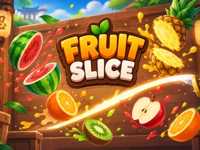
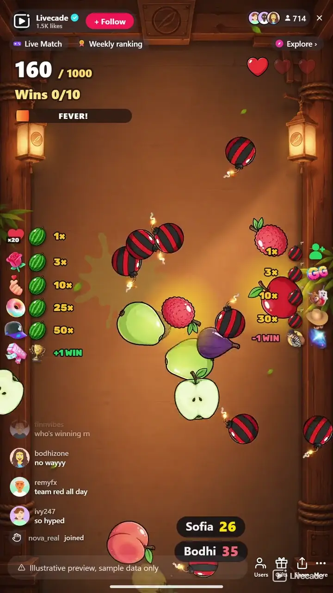

# Fruit Slice - Interactive TikTok Live Game

> You slice the fruit. Your chat sends more of it, and the bombs.

You slice flying fruit with your mouse, live, while your chat throws in more fruit to help you and bombs to stop you. Reach the target score to win the run. Slice too many bombs and it is lost.

**[Play Fruit Slice on Livecade](https://livecade.io/games/fruit-slice/?utm_source=github&utm_medium=readme&utm_campaign=fruit-slice)** - runs as a single browser source in OBS, Streamlabs, or TikTok LIVE Studio. Nothing for viewers to install.

## How viewers play

Viewers take part with the actions TikTok already gives them: **gifts**, **likes**, **follows**, **shares**, **comments**. Every action below is rebindable, so you decide which interaction drives which effect.

| Action | What it does |
| --- | --- |
| **Fruit** | Throws fruit for you to slice, as many as you set for that trigger, each with a glow that grows with the gift |
| **Bomb** | Throws lit bombs in among the fruit. Slice one and it costs a life |
| **+Win** | A golden melon with the sender's name is cut into a burst of coins: one win |
| **-Win** | A black blade cuts the Wins count in two: one win gone, even below zero |

## How it works

### You slice it, live

Hold the left mouse button and swipe across the dashboard preview. The blade and the fruit run in your own browser, so a cut lands the instant you make it, and the stream shows the same swipe a moment later. Or set the blade to Auto and it slices by itself.

### Score to the target

A run is won on the cut that reaches the target score and lost when slicing bombs has cost every life. There is no timer, and a missed fruit costs nothing.

### Gifts pour, bombs fly

A gift is a fountain of fruit under the sender's name, bigger and brighter the more it cost. Bombs come in on the same stream, so a villain can drop them into the middle of a helper's frenzy.

### Specials and a fever

Golden fruit triples your points, frozen fruit slows time, poison and stone fruit punish a careless swipe, and a full fever meter doubles your points for eight seconds.

## About the game

Fruit Slice throws fruit up across a dojo wall and hands you the blade. Hold the left mouse button and swipe through the fruit in the dashboard preview, and every cut scores. A run is a climb to a target score, 5,000 points by default. You win it on the cut that reaches the target, and you lose it only by slicing bombs until your lives are gone. There is no clock, and a fruit you miss costs nothing.

### Fruit from your helpers, bombs from your villains

On its own the game throws one or two fruit at a time, a steady stream that makes for a slow climb. Your viewers change that. A gift pours a fountain of extra fruit into the air, about six a second, with the sender's name at the bottom of the screen counting down how many are still to come. The bigger the gift, the more fruit it sends and the brighter the glow around each one. Other viewers throw bombs into the middle of it, fuses lit and in plain sight, and it is on you to cut around them.

### Golden, frozen, poison and stone

Some fruit is special. A golden fruit triples your points for five seconds, and a frozen one slows everything down for three. Later in a run a poison fruit takes 100 points off your score and a stone fruit knocks the blade out of your hand for half a second. Cut several fruit in quick succession and each one after the first pays half as much again. Slicing also fills a fever meter, and a full one doubles your points for eight seconds while the game holds back its own bombs.

### Wins on the counter

Every run you win adds one to a Wins counter, and the next run starts by itself after a short break. Viewers can move the counter too. A +Win raises a giant golden melon under the sender's name, a blade cuts it into a burst of coins, and the win flies into the count. A -Win darkens the screen and a black blade cuts the count in two. Set a win goal and reaching it ends the game on a game-over screen with a New Game button.

## What it looks like on stream

[Watch Fruit Slice gameplay](https://cdn.livecade.io/games/fruit-slice.mp4)

## What you can configure

- **Interface language** - Thirteen languages for everything on screen
- **Blade** - Slice with the mouse yourself, or let the blade slice on its own
- **Target score** - The points that win a run, from 500 to 100,000
- **Lives** - One to ten. Slicing a bomb costs one
- **Win goal** - The wins that end the game on the game-over screen, or 0 to play without one
- **Background** - The game's own dojo, or a custom scene with a solid color, a transparent background for your camera, or your own image

## Languages

English, Spanish, Portuguese, French, German, Italian, Indonesian, Arabic, Turkish, Russian, Hindi, Romanian, Filipino

## FAQ

<strong>How do viewers play Fruit Slice?</strong>

They throw things at you. Out of the box, 20 likes throw one fruit and a follow throws one bomb. Gifts do the rest: a Rose is 3 fruit, a Finger Heart 10, a Doughnut 25 and a Cap 50, while a GG is 3 bombs, a Friendship Necklace 10 and a Hat and Mustache 30. Every action can be rebound to comments, likes, follows, shares or any gift, each with its own amount.

<strong>Do I have to slice it myself?</strong>

No. Set the blade to Auto and it slices by itself, which keeps the stream moving while you talk to chat. Switch back to Manual at any time.

<strong>How do I lose a run?</strong>

Only by slicing bombs. Each one costs a life, and at zero lives the run is lost and a new one starts after a short break. Fruit you miss just falls away.

<strong>Can I win a run without my viewers?</strong>

Yes, slowly. Alone the game throws one or two fruit at a time, so the default target of 5,000 takes several minutes of clean slicing. What your viewers send is what makes a run fast.

<strong>Is Fruit Slice the same as Fruit Ninja?</strong>

No. Fruit Slice is a Fruit Ninja-style fruit slicing game built by Livecade for TikTok Live, where your viewers send the fruit and the bombs. It is its own game and is not affiliated with Halfbrick or Fruit Ninja.

<strong>How do I add Fruit Slice to my TikTok Live?</strong>

Add one browser source URL to OBS or your streaming software and go live. There is no plugin to install and nothing for your viewers to download.

## Setup

1. [Create a Livecade account](https://app.livecade.io/register?utm_source=github&utm_medium=cta&utm_campaign=fruit-slice)
2. Copy your overlay browser source URL
3. Paste it into OBS, Streamlabs, or TikTok LIVE Studio
4. Pick Fruit Slice, set your triggers, and go live

Runs in the browser, so it works on Windows and macOS with nothing to download. [See all TikTok Live games](https://livecade.io/tiktok-live-games/?utm_source=github&utm_medium=readme&utm_campaign=fruit-slice).

---

_This repository documents Fruit Slice, a hosted interactive game by [Livecade](https://livecade.io/?utm_source=github&utm_medium=footer&utm_campaign=fruit-slice). The game runs on Livecade's platform, so there is no source to install here._
